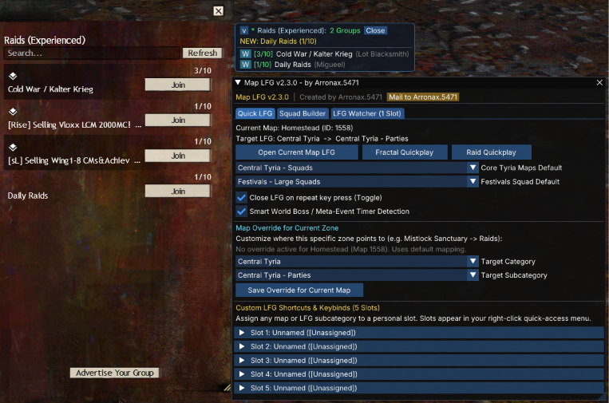
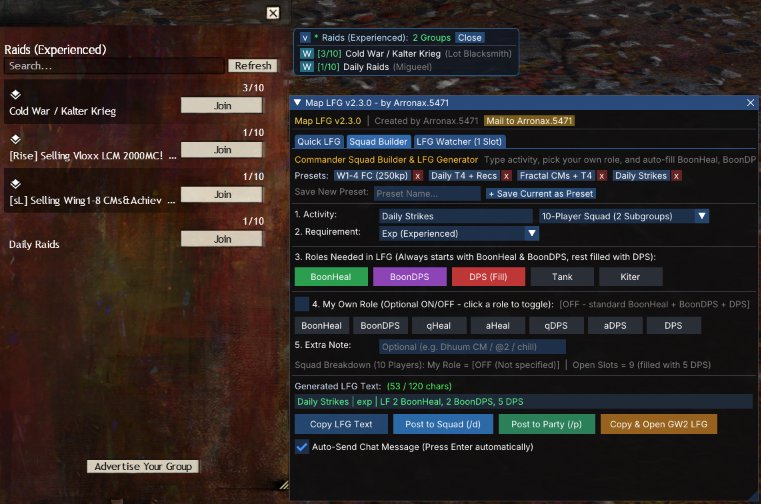
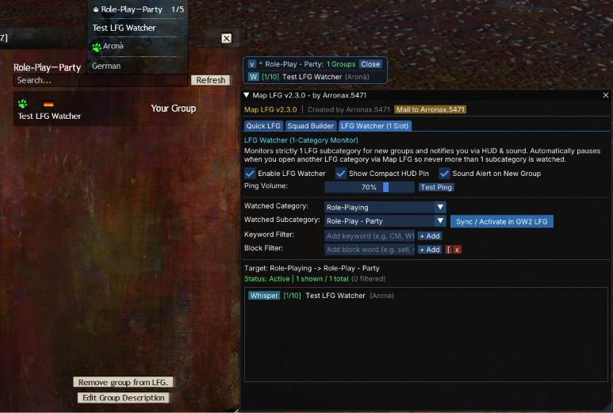

# Map LFG for Raidcore Nexus

A Guild Wars 2 addon that opens the native Looking For Group (LFG) window directly to your current map's category, monitors LFG subcategories in the background, and generates commander squad messages.

## Disclaimer

> Modifying Guild Wars 2 through any third party software is not supported by ArenaNet or its partners. You are using this addon at your own risk.

This addon is designed to comply with the official ArenaNet Third Party Program Policy. Portions or the entirety of the codebase remain closed-source in compliance with requests by ArenaNet.

## Screenshots

| Quick LFG & HUD Pin | Squad Builder & LFG Generator | LFG Watcher Settings |
| :---: | :---: | :---: |
|  |  |  |

## Features

- **Instant Map Navigation:** Press ALT+L (or click the Quick-Access icon) to open the GW2 LFG panel directly to the category matching your current zone.
- **LFG Watcher (Background Monitor):** Monitors a selected LFG subcategory without keeping the heavy native window open. Notifies you via audio pings and an optional compact HUD pin.
- **Accurate Live Squad Counts:** Displays true live group counts (e.g. 3/10, 40/50) and locked squad commander names.
- **Keyword & Block Filters:** Filter listings by required terms or block unwanted text (such as sell runs or guild recruitments).
- **Commander Squad Builder & LFG Generator:** Quickly create formatted LFG messages with boon roles (BoonHeal, BoonDPS, DPS, Tank, Kiter) and post directly to squad (/d) or party (/p).
- **In-Game Map Overrides:** Redirect any zone (e.g., Mistlock Sanctuary -> Raids) directly via in-game dropdown menus in the settings.
- **Smart World Boss Detection:** Automatically switches Central Tyria LFG to World Bosses when a world boss or the Ley-Line Anomaly is active in your current zone.
- **Custom Shortcut Slots:** Up to 5 user-configurable quick-access slots with dedicated Nexus keybinds.

## Controls & Keybinds

| Action | Default Keybind | Description |
| :--- | :--- | :--- |
| **Open Current Map LFG** | `ALT + L` | Opens LFG directly to your current zone |
| **Map LFG Settings** | `ALT + SHIFT + L` | Opens settings, Squad Builder, and Watcher configuration |
| **Quick-Access Icon** | Left Click | Opens current map LFG |
| **Quick-Access Context** | Right Click | Opens shortcut context menu and settings |

Keybinds can be customized at any time in the Raidcore Nexus settings (`CTRL + O`).

## Installation

### Method 1: In-Game Addon Library (Recommended)
1. Open the Nexus menu in-game (`CTRL + O`).
2. Go to the **Addon Library** tab.
3. Search for **Map LFG** and click **Install**.

### Method 2: Manual Installation
1. Ensure Raidcore Nexus is installed.
2. Download `Map_LFG.dll` from the latest Release.
3. Place `Map_LFG.dll` into your `Guild Wars 2/addons/` folder.
4. Restart Guild Wars 2 or load the addon via the Nexus overlay (`CTRL + O`).

## Author & Support

- **Author:** Arronax.5471
- **Community Discord:** https://discord.gg/BPXw54Dghq
